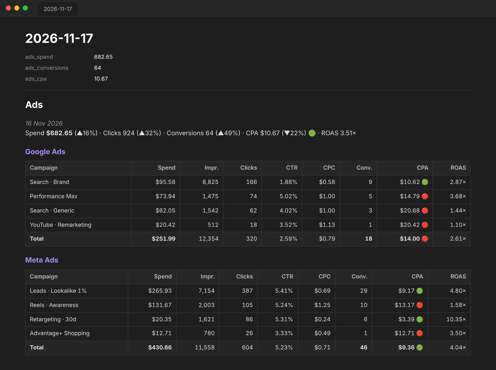

# Ad Recap

[](https://github.com/chi-li-peppers/obsidian-ad-recap/releases/latest)
[](https://github.com/chi-li-peppers/obsidian-ad-recap/actions/workflows/ci.yml)
[](LICENSE)


Your Google Ads and Meta Ads numbers, right inside Obsidian.

Ad Recap pulls campaign metrics into your notes as clean Markdown tables: spend, impressions, clicks, CTR, CPC, conversions, CPA and ROAS, with changes against the previous period. Open today's daily note and yesterday's results are already there.



## Features

- **Google Ads** via the official API, or **without a developer token** through a small Google Ads script that fills a Google Sheet
- **Meta Ads** (Facebook and Instagram) via the Marketing API, with your own choice of conversion actions
- **Daily note automation**: when today's note is created, yesterday's report is added under a heading you choose
- **Note properties**: `ads_spend`, `ads_clicks`, `ads_conversions`, `ads_cpa`, `ads_roas` are saved to the daily note, so you can chart trends with Bases or Dataview
- **Live block**: put an `ad-recap` code block in any note for a report that refreshes on open
- **Target CPA** flags: 🟢 at or under target, 🔴 above
- **Period comparison**: ▲/▼ against the period of the same length just before
- **Works on mobile**: all requests go through Obsidian's own network API
- **Demo mode** to try everything before connecting an account

## Commands

| Command | What it does |
| --- | --- |
| Insert report: yesterday | Adds yesterday's report at the cursor |
| Insert report: last 7 days | Adds a 7-day report at the cursor |
| Insert report: choose period… | Pick a period, or type `2026-11-01..2026-11-15` |
| Update report in current daily note | Refreshes the report section and properties of the open daily note |
| Insert live report block | Adds an `ad-recap` block at the cursor |

## Live block

````markdown
```ad-recap
range: last_7d
source: all
compare: true
```
````

- `range`: `today`, `yesterday`, `last_7d`, `last_14d`, `last_30d` (any `last_Nd`), `this_month`, `last_month`, a date like `2026-11-16`, or `2026-11-01..2026-11-15`
- `source`: `all`, `google` or `meta`
- `compare`: `true` or `false`

Results are cached for 10 minutes. Use the **Refresh** button for fresh numbers.

## Connecting Google Ads

### Option A: Google Sheet (no developer token, about 5 minutes)

1. Create an empty Google Sheet.
2. In Google Ads, open **Tools → Bulk actions → Scripts**, add a script and paste [`scripts/google-ads-to-sheet.js`](scripts/google-ads-to-sheet.js). Put your sheet URL in `SHEET_URL`.
3. Authorize and run it once, then set it to run daily.
4. In the sheet: **File → Share → Publish to web**, pick the first sheet and **CSV**, then **Publish**.
5. In Ad Recap settings, enable Google Ads, choose **Google Sheet** and paste the CSV link.

Anyone with the published link can read the CSV. It's an unguessable URL, but keep that in mind.

### Option B: Google Ads API

You need:

- A **developer token** from the API Center of a Google Ads manager account
- An **OAuth client** (Desktop app) from Google Cloud Console, with the Google Ads API enabled
- A **refresh token** for the scope `https://www.googleapis.com/auth/adwords`. The quickest way is the [OAuth 2.0 Playground](https://developers.google.com/oauthplayground): open the settings gear, tick *Use your own OAuth credentials*, paste your client ID and secret, authorize the scope above and exchange the code for tokens.

Then fill in the customer ID(s), the manager account ID if you use one, the developer token, client ID, client secret and refresh token, and press **Test Google Ads**.

## Connecting Meta Ads

1. In [Meta Business Settings](https://business.facebook.com/settings), create a **System user**, give it access to your ad account(s), and generate a token with the `ads_read` permission.
2. Paste the token and your ad account ID(s) (with or without `act_`).
3. Set **Conversion actions** to the action types you count as conversions, for example `purchase`, `lead` or `offsite_conversion.fb_pixel_lead`.
4. Press **Test Meta Ads**.

## Privacy

- Ad Recap talks only to `googleads.googleapis.com`, `oauth2.googleapis.com`, `graph.facebook.com` and the Google Sheet link you provide. Nothing is sent anywhere else.
- Tokens are stored in this vault's plugin data file (`.obsidian/plugins/ad-recap/data.json`). If your vault is synced or shared, the tokens go with it.

## Install

Search for **Ad Recap** in **Settings → Community plugins**, or install manually: copy `main.js`, `manifest.json` and `styles.css` from the [latest release](../../releases/latest) to `<vault>/.obsidian/plugins/ad-recap/` and enable the plugin.

## Roadmap

- [ ] More platforms: Microsoft Ads, TikTok Ads, LinkedIn Ads
- [ ] Breakdown by ad group / ad set
- [ ] Weekly and monthly notes support
- [ ] Budget pacing alerts

Ideas and votes are welcome in [issues](https://github.com/chi-li-peppers/obsidian-ad-recap/issues).

## Contributing

Bug reports, ideas and pull requests are welcome. See [CONTRIBUTING.md](CONTRIBUTING.md). For security issues, see [SECURITY.md](SECURITY.md).

## Disclaimer

Ad Recap is an independent project and is not affiliated with or endorsed by Google, Meta or Obsidian. Google Ads is a trademark of Google LLC. Meta is a trademark of Meta Platforms, Inc.

## License

[MIT](LICENSE) © 2026 David ([chi-li-peppers](https://github.com/chi-li-peppers))
